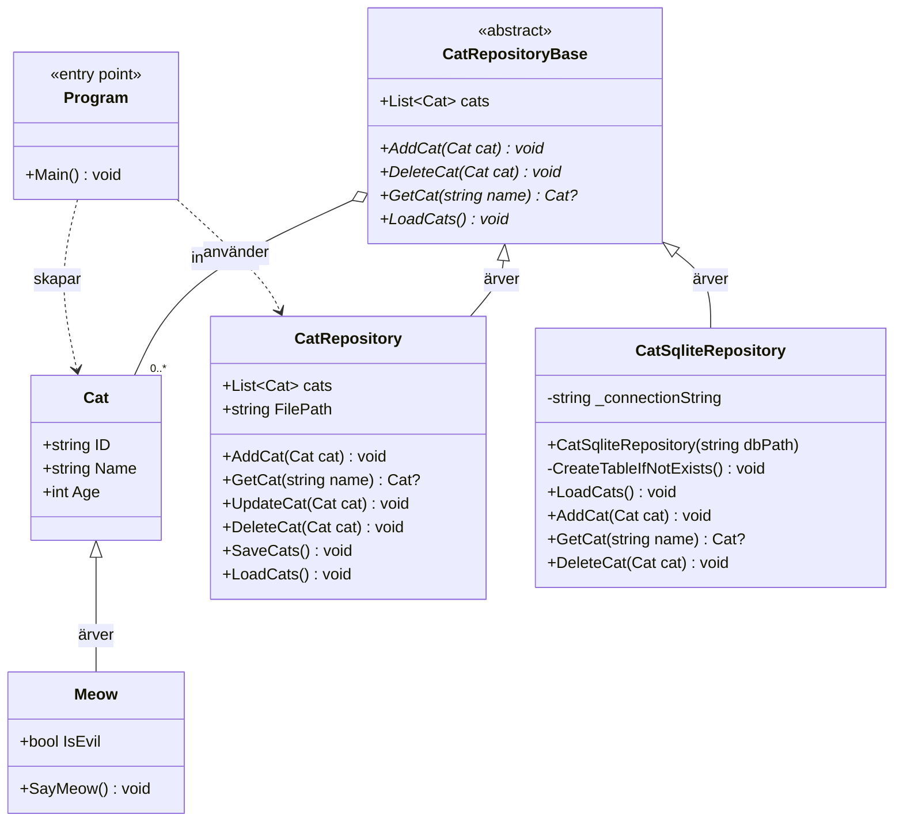
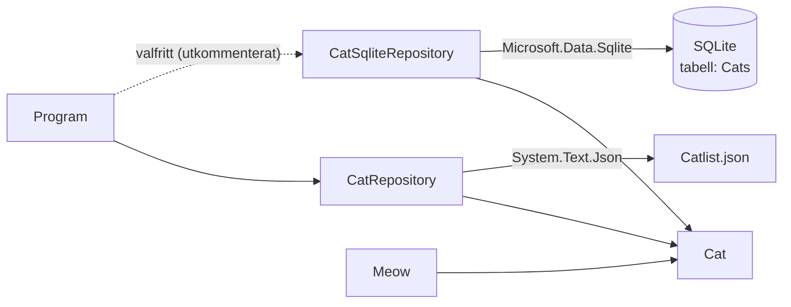
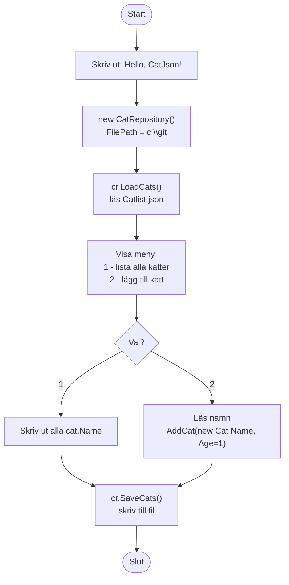
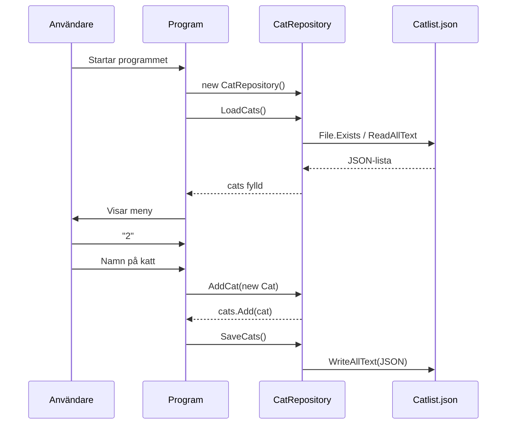
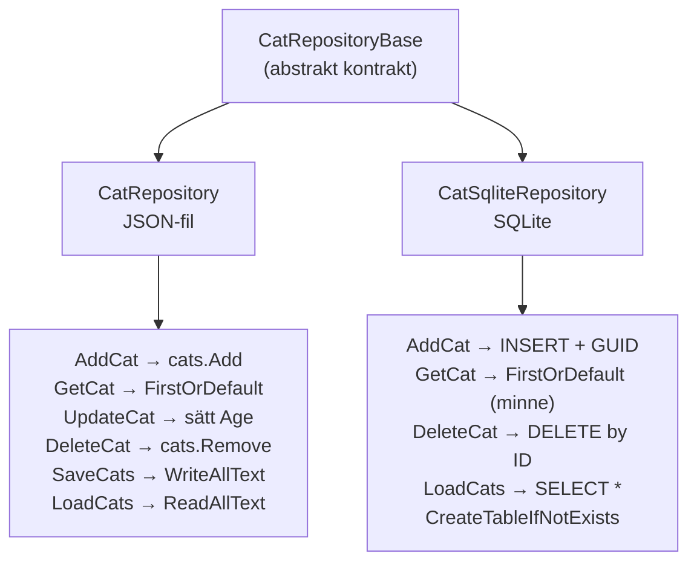

# CatJson — UML-översikt

Översikt över hela projektet i Mermaid. Diagrammen är genererade utifrån
källkoden i `CatJson`-projektet (`.NET 10`, konsolapp).

---

## Klassdiagram

**Läsning:**
- `Cat` är datamodellen — en katt med `ID`, `Name`, `Age`.
- `Meow` ärver `Cat` (oavslutad/platshållare — `SayMeow()` kastar `NotImplementedException`).
- `CatRepositoryBase` är ett abstrakt kontrakt för CRUD på katter.
- `CatRepository` lagrar till JSON-fil (`Catlist.json`).
- `CatSqliteRepository` lagrar till SQLite-databas — samma kontrakt, annan lagring.
- `Program` är startpunkten och väljer vilket repository som används.

---

## Beroenden & paket

---

## Programflöde (menyn)

---

## Sekvensdiagram — lägg till en katt

---

## Lagring — två implementationer av samma kontrakt

> **Not:** `CatRepositoryBase` saknar `SaveCats()` och `UpdateCat()` i kontraktet —
> de finns bara på `CatRepository`. `CatSqliteRepository` sparar istället direkt
> vid varje `AddCat`/`DeleteCat` och behöver därför ingen separat `SaveCats()`.
